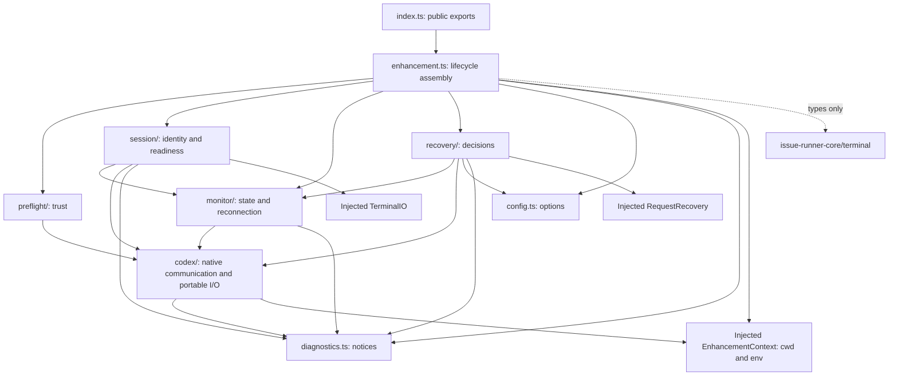

# Code architecture

Use this map to place enhancement code and tests. Interface behavior belongs in [Core's public integration contract](https://github.com/BuddyLabsCo/issue-runner-core/blob/main/docs/terminal-contract.md); native interactions belong in [Codex protocol](codex-protocol.md).

## Directory map

```text
/
|-- src/
|   |-- index.ts               # Public contractVersion and createEnhancement exports
|   |-- enhancement.ts         # Per-Tab lifecycle assembly and coordinated cleanup
|   |-- config.ts              # Enhancement option validation and defaults
|   |-- diagnostics.ts         # Redacted notices on inherited Runner stderr
|   |-- preflight/             # Effective checkout and hook trust before startup
|   |-- session/               # GUID identification and verified model-start readiness
|   |-- monitor/               # Bound conversation, Assignment, state and reconnection
|   |-- recovery/              # Recovery eligibility, budgets, waits and cancellation
|   `-- codex/                 # Native protocol, Git discovery and portable file I/O
|-- tests/
|   |-- unit/                  # Static architecture and quality rules
|   |-- integration/           # Public lifecycle through injected/native substitutes
|   |-- package/               # Installed exports, runtime isolation and Core types
|   |-- fixtures/              # Bound I/O, controlled clock and native byte bridge
|   `-- release/               # Release scripts through Git/GitHub/npm fixtures
|-- scripts/release/           # Independent candidate and publication tooling
|-- docs/                      # Protocol, architecture and agent instructions
|-- .github/workflows/         # Checks and tests on Ubuntu and Windows
`-- dist/                      # Generated JavaScript and declarations
```

## Dependency direction

Arrows show dependencies. Core's terminal contract is a development-only type dependency; injected capabilities supply runtime access.



## Module ownership

Keep policy with the feature that owns it; keep native I/O behind `codex/`.

| Owner | Responsibilities |
| --- | --- |
| `index.ts` | Export only `contractVersion = 2` and `createEnhancement`. |
| `enhancement.ts` | Validate configuration, connect, await preflight, assemble per-Tab instances, and expose the four lifecycle methods. Coordinate immediate cancellation and retryable resource cleanup. |
| `config.ts` | Validate shared enhancement options and apply defaults. Configuration-field explanations live in Core's template comments. |
| `preflight/` | Establish and verify primary checkout trust, replacing an explicit `untrusted` value when necessary. Preserve separate distrust overrides for the task cwd or Worktree, disabled hooks, unrelated settings and persisted writes. Trust current hook hashes and verify readback. |
| `session/` | Submit GUID markers through bound I/O, identify the enclosing native conversation, and correlate the bootstrap prompt with its model turn start. Own readiness deadlines and retry evidence. |
| `monitor/` | Bind one exact native ref, retain Assignment ID and expected file together, filter notifications, refresh snapshots and reconnect. Invalidate stale asynchronous observations on replacement, new turns, disconnect and stop. |
| `recovery/` | Decide eligibility from current facts, complete final replies and file presence. Own separate budgets, delays, cancellation and originating-Assignment rechecks before calling `requestRecovery(id)`. |
| `codex/` | Start/connect to the shared daemon, implement framed WebSocket RPC over the owned proxy, configuration/hook operations, Git checkout discovery and file existence checks. Release only owned connections and proxies. |
| `diagnostics.ts` | Format enhancement notices without native payloads, credentials or transport close reasons. |
| `scripts/release/` | Own release identity, candidate packing and publication recovery independently of enhancement runtime code. |

## Code placement rules

- Keep public lifecycle assembly in `enhancement.ts`. Helpers stay beside their owner; add a module when needed.
- Put native protocol validation and portable filesystem/process access in `codex/`. That layer must not import lifecycle or feature modules.
- Keep `config.ts` and `diagnostics.ts` independent of feature policy and native I/O.
- Use only public type imports from `issue-runner-core/terminal`. Do not import Core workflow internals or depend on concrete terminal packages. Core remains a development dependency, without runtime or peer coupling.
- Use bound `TerminalIO` for readiness input and the injected `RequestRecovery` callback for business recovery. Never compose continuation text or submit business turns through native RPC. A fulfilled callback may be Core's stale no-op.
- Leave interactive start/resume commands and input serialization to the terminal. Core owns orchestration, readiness pause/retry, capability revocation, queued stale-input checks, recovery wording, handoff validation and tab closure. Task handoffs supply PR metadata.
- Preserve the shared daemon, unrelated conversations, terminal, native history and persisted configuration. Stop cancels observation, readiness, recovery and reconnect work immediately, then waits for issued input/callbacks and releases owned resources. Concurrent stops share one attempt; later stops retry unfinished releases after failure.
- **OS-specific code is prohibited everywhere in this repository**, including adapters, tests and fixtures. Do not add platform branches, OS-specific commands, fixed native paths or socket conventions, shell-dependent execution, PTY handling or native key codes. Use portable Node APIs and injected capabilities; there is no adapter exception.

## Test placement rules

Test public behavior at existing boundaries; fixtures substitute capabilities and native protocol, not Core workflow internals.

| Location | Coverage boundary |
| --- | --- |
| `tests/unit/` | Static import direction, file size, typed Promise rules and repository-wide OS independence. |
| `tests/integration/` | Public factory/lifecycle, option validation, trust, binding, readiness, observation, recovery, cancellation and cleanup. Use controlled time, bound terminal I/O, recovery callbacks and the scripted native byte bridge. Git discovery also uses temporary ordinary and linked checkouts. |
| `tests/fixtures/` | Reusable injected capabilities, native responses and clock control; no concrete terminal dependency. |
| `tests/package/` | Built exports and declarations, production installation/import with Core resolution blocked, then an exact registry Core development consumer. Verify a supplied candidate unchanged. |
| `tests/release/` | Release identity, proposal eligibility, packing and publication recovery through portable Git fixtures and GitHub/npm substitutes. |

Substitutes do not prove real native terminal/model behavior, live publishing permissions or npm activation acceptance. Reuse recorded acceptance evidence for those boundaries. Build and check commands are in the [README](../README.md#developing-the-codex-enhancement).
