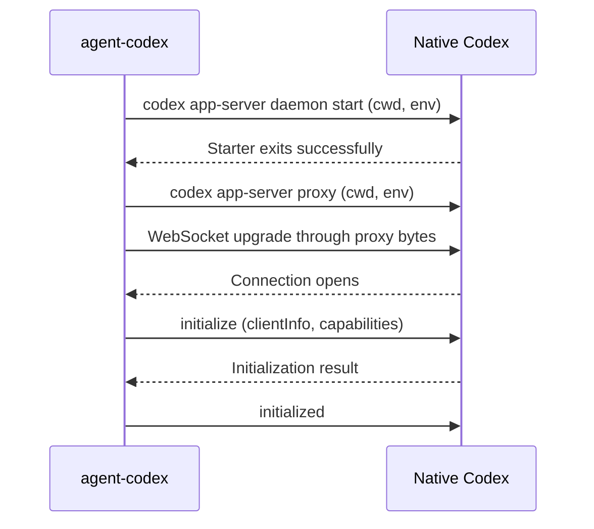
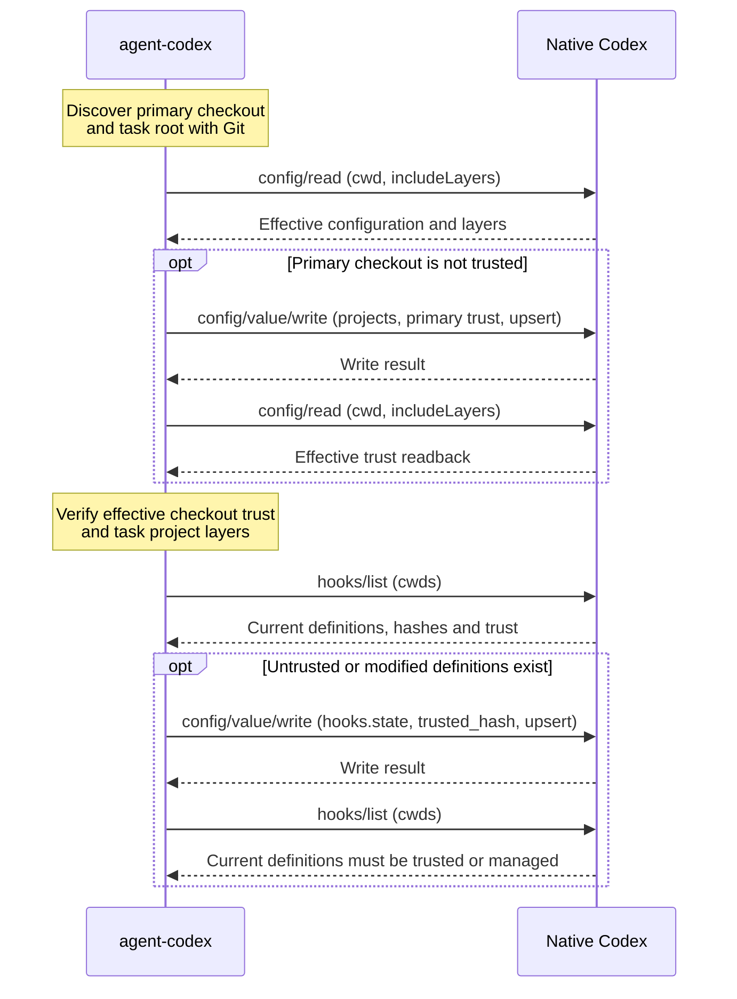
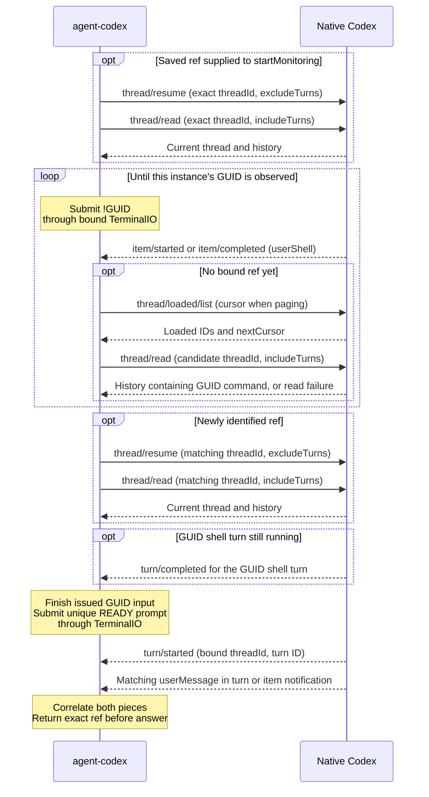
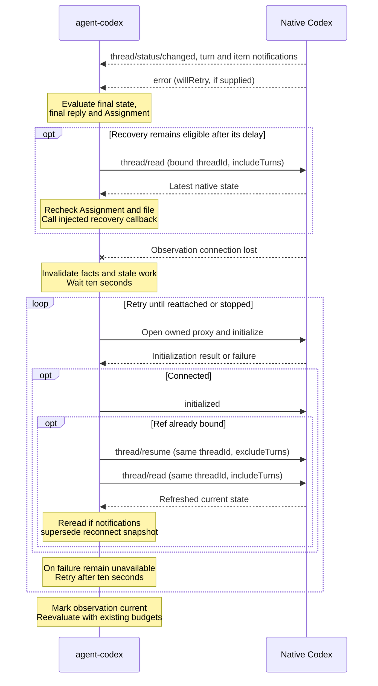
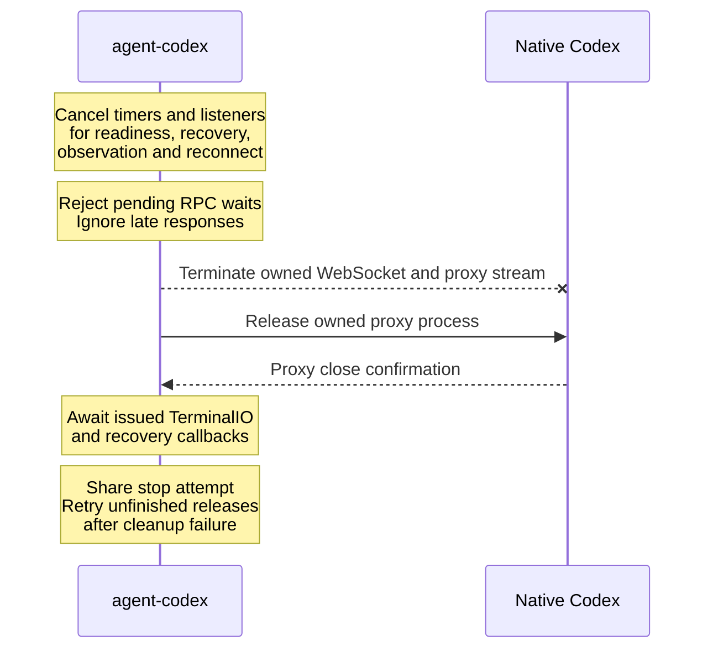

# Codex protocol

## Native interface inventory

The enhancement owns native communication through `src/codex/`; the terminal owns interactive Codex commands. This inventory describes the **0.166.0** protocol baseline actually used by the implementation. See [Core's public contract](https://github.com/BuddyLabsCo/issue-runner-core/blob/main/docs/terminal-contract.md) for injected capabilities.

| Native command | Purpose |
| --- | --- |
| `codex app-server daemon start` | Ensure the shared daemon exists using the supplied cwd/environment. |
| `codex app-server proxy` | Open an owned proxy to that daemon. The proxy carries WebSocket upgrade and framed JSON messages, not JSONL RPC; native Codex discovers the endpoint. |

| Request | Purpose and fields used |
| --- | --- |
| `initialize` | Identify the enhancement with `clientInfo`; disable `experimentalApi` and `requestAttestation`. |
| `config/read` | Read effective configuration for `cwd` with `includeLayers: true`; verify project trust and enabled project layers. |
| `config/value/write` | Upsert structured `projects` or `hooks.state` values through `keyPath`, `value` and `mergeStrategy: "upsert"`. Native Codex serializes path keys. |
| `hooks/list` | List current definitions for `cwds: [cwd]`, including hashes, trust, enabled state and inventory errors. |
| `thread/loaded/list` | Enumerate loaded conversation IDs through `cursor`/`nextCursor` while discovering the GUID marker. |
| `thread/resume` | Attach this observer to the exact `threadId` with `excludeTurns: true`, without settings overrides or business input. |
| `thread/read` | Read the exact `threadId` with `includeTurns: true` for discovery, initial state and recovery/reconnect refreshes. |

The client sends the `initialized` notification after successful initialization. Incoming event notifications supply these facts:

| Event notification | Purpose |
| --- | --- |
| `thread/started` | Trigger another discovery scan before binding. |
| `thread/status/changed` | Update the bound thread's active, idle or system-error status. |
| `turn/started` | Track the latest turn and correlate the readiness prompt with its turn ID. |
| `turn/completed` | Observe final turn state or trigger discovery before binding. |
| `item/started`, `item/completed` | Observe `commandExecution` items with `source: "userShell"`, bootstrap `userMessage` evidence and complete `agentMessage` replies. |
| `error` | Retain `willRetry` for the bound latest turn; suppress business recovery while native retry is active. |

Requests use numeric IDs and bounded waits. Only `hooks/list`, `config/read`, `thread/read`, and `thread/loaded/list` retry timeouts or service errors: three attempts maximum, ten seconds per attempt, and one second between attempts. Retries use fresh IDs on the same connection; disconnect or stop cancels them. Successful-response validation failures and other methods never retry. Each failed attempt goes to the shared Codex log; intermediate retries add no terminal notice.

After binding, notifications must match the exact `threadId`; error evidence must also match the latest turn. The enhancement sends no native business-turn, interrupt, unsubscribe or daemon-stop requests. Full-history `thread/read` is deprecated for paginated threads; native-version changes may require migration. Protocol shapes were checked against the generated 0.166.0 schema; [native readiness evidence](https://github.com/BuddyLabsCo/issue-runner-agent-codex/issues/29) records the model-start persistence probe.

## Enhancement logging

All enhancement instances in one CLI process synchronously append to the same active JSONL file. The first instance selects `resolve(cwd, "..", "..", "..", "logs")`: `<project>/worktrees/<run>/<ticket>` maps to `<project>/logs`. There is no project-root discovery. Reconnects and instance cleanup preserve the shared sink; another CLI process starts a new sequence.

Files are named `agent-codex-log-<timestamp>.jsonl`. UTC timestamps include milliseconds and replace colons with hyphens. Exclusive creation advances the candidate timestamp on collisions. Appends count UTF-8 bytes and rotate a nonempty file before exceeding 2,097,152 bytes. Each JSONL record stays intact. A single oversized record may exceed the limit; the next record rotates. No files are deleted automatically.

`terminalPlugins.enhancements.logLevel` accepts `error` (default) or `info`. Invalid configuration failures are logged before startup. Errors retain original details, stacks and causes without redaction, including failed attempts that later succeed. Normal exits, ordinary stderr and configuration warnings are info events.

At info level, records identify daemon/proxy starts and owned cleanup, transport connections and reconnects, RPC attempts, Git queries, configuration/hook operations, expected-file checks, terminal submissions and Core recovery callback invocations. Request metadata describes initiation; successful response payloads, full terminal bodies and elapsed durations are excluded. The enhancement does not log Codex's internal tool, shell or network activity.

Wait and deadline scheduling records include their reason, planned `delayMs` and `scheduledFor`. Execution, cancellation and timeout produce separate records. This covers recovery, reconnect, RPC retry, readiness retry and operation deadlines.

Records include `time`, `level`, `event`, invocation `runId`, enhancement `instanceId` and `cwd`. Available `sessionref`, `assignmentId` and `turnId` fields retain the operation's originating context through asynchronous completion or cancellation. IDs stay stable through rotation; `runId` is generated for logging rather than supplied by Core. Logging failures remain nonfatal and keep their stderr diagnostics. The logfile path notice is removed; other terminal notices remain unchanged.

## Interaction sequences

### Connection and initialization

The owned proxy connects to the existing shared daemon; the enhancement does not start an interactive Agent or private server.

### Checkout and hook trust

Portable Git discovery identifies the ordinary primary checkout, including from a linked Worktree. Preflight establishes primary checkout trust, replacing an explicit `untrusted` value when necessary, then checks separate task cwd or Worktree overrides. Those distrust overrides or a disabled project layer reject startup; warnings alone do not.

Hook writes preserve enabled flags and unrelated state. Persisted trust survives later failure or cleanup. Checkout trust failures release only the enhancement's connection and proxy. Hook preflight failures are logged and allow readiness to proceed. Trusted, managed, or empty inventories require only the first query.

### Conversation identification and readiness

Readiness submits markers and the bootstrap prompt only through injected terminal I/O. A failed GUID shell command still proves identity through its native record. A supplied ref restricts discovery to that exact conversation.

GUID rounds repeat after two seconds while previous input has settled. Once the GUID is observed, readiness stops marker rounds and waits for its shell turn to end before submitting the READY prompt. Command item completion alone does not end the turn. An ended GUID turn in history also permits bootstrap without waiting for another completion notification.

Candidate history RPC failures allow other candidates and later scans; malformed required data rejects readiness. Each wait has its own deadline. Retry retains the instance's GUID, discovered ref and observation without replaying the Agent command. Model-start evidence lets settings persist before Core saves the ref; it does not repair settings lost by an older GUID-only session.

### State observation and reconnection

Recovery decisions use the latest bound thread, originating Assignment and expected file. Core receives only recovery requests; the enhancement never sends continuation text through native RPC.

Reconnect restores subscriptions and current facts without replaying events, restarting Codex, reconstructing historical retry evidence or spending recovery attempts. Before binding, it restores availability without selecting a conversation. New turns, Assignment replacement, disconnect and stop invalidate stale work; refreshed facts use the same recovery and human-action rules.

### Stop and cleanup

Stop disables activity immediately, waits for issued injected operations, and releases only owned resources. After connection and native readiness return the actual sessionid, enhancement operation and cleanup failures are logged without rejecting contract calls.

Real terminal-input and recovery-prompt delivery failures retain their existing handling. Stop has a ten-second overall bound after readiness; unfinished releases remain retryable. Native history, persisted settings, other sessions and the shared daemon survive.

